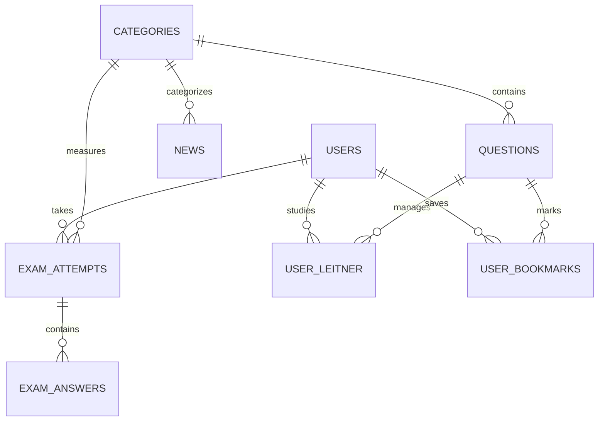

# مستندات جامع فنی و راهنمای استقرار پلتفرم تست ۹۸ (test98.ir)

---

## ۱. نمای کلی سیستم (System Overview)

پلتفرم **تست ۹۸** (`test98.ir`) یک سامانه یکپارچه، سبک و خودکار در حوزه آموزش و آزمون‌های استخدامی کشور است که بر اساس فناوری‌های مدرن **FastAPI + SQLite WAL + HTMX + Alpine.js + Tailwind CSS** پیاده‌سازی شده است.

این پلتفرم از ترکیب سه رکن اصلی ساخته شده است:
1. **خزشگر هوشمند تلگرام (Telegram Pipeline):** استخراج مداوم و نوبتی سوالات چهارگزینه‌ای و اخبار استخدامی از کانال‌های تلگرامی معتبر بدون نیاز به مداخله انسانی.
2. **موتور آزمون‌ساز تطبیقی (Adaptive Exam Engine):** ساخت آزمون‌های آنلاین سفارشی و استاندارد، ترکیب هوشمند سوالات (دیده‌نشده، اشتباهات قبلی، لایتنر)، محاسبه نمره منفی، تراز کشوری (T-Score) و کارنامه تحلیلی آنی.
3. **خبرخوان و قیف تبدیل به آزمون (SEO & Conversion Funnel):** انتشار خودکار اطلاعیه‌ها و دفترچه‌های استخدامی با ساختار بهینه‌سازی‌شده برای سئو گوگل و هدایت مستقیم کاربران ورودی به آزمون‌های مرتبط.

---

## ۲. نگاشت کانال‌های تلگرام و چرخه خزش ۳۰ دقیقه‌ای

### ۲.۱. جدول نگاشت کانال‌ها به بخش‌های سایت

| آدرس کانال تلگرام | نام و موضوع کانال | ماژول مقصد | کد دسته در دیتابیس | نوع محتوا |
| :--- | :--- | :--- | :--- | :--- |
| `https://t.me/ICDL100` | مهارت‌های هفت‌گانه ICDL | بانک سوالات | `icdl` | سوال تستی و نظرسنجی |
| `https://t.me/camputerraheeestekhdam` | فناوری اطلاعات و کامپیوتر | بانک سوالات | `computer` | سوال تستی و جزوه |
| `https://t.me/gavaninraheeestekhdam` | قوانین و مقررات اداری | بانک سوالات | `laws` | سوال تستی و مواد قانون |
| `https://t.me/maarefraheeeestekhdam` | معارف و اندیشه اسلامی | بانک سوالات | `maaref` | سوال تستی و نکات |
| `https://t.me/maarefehrah` | معارف و اطلاعات عمومی | بانک سوالات | `maaref` | سوال تستی و گزینش |
| `https://t.me/Iranestekhdam_ir` | ایران استخدام | خبرخوان | `employment` | آگهی‌ها و دفترچه‌ها |
| `https://t.me/raheeestekhdam2` | راه استخدام ۲ | ترکیبی | `employment` | اخبار و نمونه سوال |
| `https://t.me/nerkh_net` | نرخ نت | خبرخوان | `economy` | اخبار اقتصادی و استخدامی |

---

### ۲.۲. استراتژی زمان‌بندی نوبتی (Round-Robin Worker)
بر اساس نیاز سیستم، یک پس‌زمینه زمان‌بندی‌شده (`periodic_crawler_worker`) در چرخه حیات سرور تعریف شده است:
- **فاصله زمانی:** هر ۳۰ دقیقه یک‌بار (`1800` ثانیه).
- **انتخاب کانال:** از بین کانال‌های فعال در جدول `crawler_channels`، کانالی که قدیمی‌ترین زمان خزش (`last_crawled_at ASC NULLS FIRST`) را دارد انتخاب می‌شود.
- **خزش به عقب (Backward Pagination):**
  - فیلد `oldest_msg_id` در جدول کانال‌ها نگهداری می‌شود.
  - هنگامی که خزشگر به پیام‌های تکراری برخورد می‌کند، آنها را نادیده گرفته و به سمت شناسه‌های قدیمی‌تر کانال (`?before={oldest_msg_id}`) به عقب حرکت می‌کند تا حتی آرشیو گذشته کانال‌ها نیز به تدریج استخراج شود.

---

### ۲.۳. معماری دو لایه استخراج داده‌ها

```
                         ┌──────────────────────────────────────────┐
                         │      Telegram Source Channels (8)        │
                         └────────────────────┬─────────────────────┘
                                              │
                    ┌─────────────────────────┴─────────────────────────┐
                    ▼                                                   ▼
       ┌───────────────────────────┐                       ┌───────────────────────────┐
       │ Layer 1: Public Web Crawl │                       │  Layer 2: Telethon Userbot│
       │ (https://t.me/s/{channel})│                       │ (MTProto + SendVoteRequest)
       │ - بدون نیاز به فیلترشکن   │                       │ - نیاز به API ID / Hash   │
       │ - بدون نیاز به API Key    │                       │ - کشف کلید Quiz با رای    │
       └────────────┬──────────────┘                       └─────────────┬─────────────┘
                    │                                                   │
                    └─────────────────────────┬─────────────────────────┘
                                              ▼
                         ┌──────────────────────────────────────────┐
                         │   Regex & Sanitizer (Parser Module)      │
                         │ - حذف تبلیغات (پکیج، تخفیف، رزرو تبلیغ) │
                         │ - حذف آیدی‌ها و لینک‌های t.me             │
                         │ - تفکیک ۴ گزینه و کشف گزینه صحیح          │
                         └────────────────────┬─────────────────────┘
                                              ▼
                         ┌──────────────────────────────────────────┐
                         │ Deduplication Engine (RapidFuzz + MD5)   │
                         │ - بررسی هش متن صورت سوال                 │
                         │ - شباهت متنی Token Sort Ratio >= 85%     │
                         └────────────────────┬─────────────────────┘
                                              ▼
                         ┌──────────────────────────────────────────┐
                         │       SQLite Production Database         │
                         │ (questions, news, news_fts, questions_fts)│
                         └──────────────────────────────────────────┘
```

1. **لایه اول (Public Web Scraper - پیش‌فرض و آماده به کار):**
   - از پروتکل وب تلگرام (`https://t.me/s/{channel}`) با کتابخانه‌های `httpx` و `beautifulsoup4` استفاده می‌کند.
   - نیازی به پراکسی، فیلترشکن یا ثبت‌نام تلگرام ندارد.
   - نظرسنجی‌ها و پیام‌های متنی کانال‌های عمومی را مستقیماً دریافت و به عقب صفحه‌بندی می‌کند.
2. **لایه دوم (Telethon Userbot - اختیاری برای کانال‌های خصوصی یا کوییزهای قفل):**
   - با تنظیم متغیرهای `TELEGRAM_API_ID` و `TELEGRAM_API_HASH` در فایل `.env` فعال می‌شود.
   - در صورت برخورد با کوییزهای تلگرام، متد `SendVoteRequest` را فراخوانی کرده و گزینه صحیح را به صورت قطعی استخراج می‌کند.

---

### ۲.۴. فیلتر ضدتبلیغات و پالایش داده‌ها (Sanitization)
- تمام پست‌های دارای کلمات تبلیغاتی نظیر «تخفیف ویژه»، «رزرو تبلیغات»، «پکیج طلایی»، «قیمت فقط» حذف می‌شوند.
- تمام آدرس‌های کانال تلگرامی (`@...` و `t.me/...`) به صورت خودکار با عبارات منظم از متن سوالات و اخبار پاک می‌شوند تا محتوای بومی پلتفرم تست ۹۸ حفظ گردد.
- موتور رفع هم‌پوشانی (Deduplicator) با الگوریتم `Token Sort Ratio` با آستانه ۸۵٪ مانع از ورود سوالات تکراری که در چند کانال فوروارد شده‌اند می‌شود.

---

## ۳. معماری پایگاه داده (Database Schema)

پایگاه داده در فایل `test98.db` با موتور SQLite با بهینه‌سازی‌های زیر راه‌اندازی شده است:
- **`PRAGMA journal_mode = WAL;`** (امکان خواندن و نوشتن همزمان با سرعت بالا بدون قفل شدن)
- **`PRAGMA busy_timeout = 10000;`** (۱۰ ثانیه انتظار خودکار در شرایط ترافیک بالا)
- **`PRAGMA cache_size = -64000;`** (۶۴ مگابایت کش رم برای ایندکس‌ها)
- **`PRAGMA synchronous = NORMAL;`** (حداکثر کارایی I/O با تضمین تمامیت داده‌ها)

### جداول اصلی دیتابیس:



1. **`categories`:** کد دسته (`code`)، عنوان فارسی (`name_fa`)، آیکون و وضعیت ماژول آزمون.
2. **`questions`:** شناسه، صورت سوال (`question_text`)، آرایه JSON چهار گزینه (`options_json`)، نمایه گزینه درست (`correct_index`)، توضیح تشریحی (`explanation`)، کد دسته، کانال مبدا، شناسه تلگرام، وضعیت بررسی (`published` یا `needs_review`) و هش یکتایی.
3. **`news`:** اخبار استخدامی، تیتر استاندارد سئو (`title`)، اسلاگ یکتا (`slug`)، متن کامل و خلاصه، منبع، تاریخ و تگ‌ها.
4. **`exam_attempts`:** ثبت سوابق آزمون کاربر، دسته، درصد خام (`raw_score`)، تراز کشوری (`t_score`)، تعداد درست، غلط، نزده و زمان سپری‌شده.
5. **`exam_answers`:** جزئیات گزینه انتخابی کاربر برای هر سوال در هر آزمون.
6. **`user_leitner`:** وضعیت جعبه لایتنر کاربر برای هر سوال (سطح ۱ تا ۵، تاریخ بررسی بعدی، تعداد درستی متوالی).
7. **`user_bookmarks`:** سوالات نشان‌دارشده توسط کاربران.
8. **`crawler_channels`:** جدول پیکربندی و مانیتورینگ کانال‌ها شامل `last_msg_id`، `oldest_msg_id` و `last_crawled_at`.
9. **`news_fts` و `questions_fts`:** جداول جستجوی تمام‌متن با موتور سریع FTS5 SQLite.

---

## ۴. موتور آزمون‌ساز هوشمند و فرمول‌ها

### ۴.۱. ترکیب وزنی هوشمند سوالات (Blender)
در هنگام ساخت آزمون سفارشی یا جامع، سوالات بر اساس توزیع بهینه روان‌سنجی انتخاب می‌شوند:
- **۶۰٪ سوالات:** جدید و مشاهده‌نشده توسط داوطلب.
- **۳۰٪ سوالات:** سوالاتی که کاربر قبلاً در آزمون‌های دیگر اشتباه پاسخ داده است (استخر خطا).
- **۱۰٪ سوالات:** سوالات حاضر در جعبه لایتنر که تاریخ مرور آن‌ها فرارسیده است.

### ۴.۲. فرمول نمره خام و درصد با اعمال نمره منفی یک‌سوم
$$Score = \max\left(0, \frac{R - \frac{W}{3}}{N} \times 100\right)$$
که در آن:
- $R$: تعداد پاسخ‌های صحیح
- $W$: تعداد پاسخ‌های غلط (هر غلط یک‌سوم درست را می‌سوزاند)
- $N$: تعداد کل سوالات آزمون

### ۴.۳. فرمول محاسبه تراز کشوری استاندارد (T-Score)
$$T = 500 + 100 \times \left(\frac{\text{Score} - \mu}{\sigma}\right)$$
- میانگین جامعه ($\mu$): ۵۰٪
- انحراف معیار جامعه ($\sigma$): ۱۵٪
- تراز نهایی درون محدوده ۲۰۰ الی ۸۰۰ نرمالیزه می‌شود.

### ۴.۴. رتبه‌بندی درون‌دیتابیسی (Window Function)
رتبه داوطلب در مقایسه با تمام شرکت‌کنندگان آن دسته با کوئری کارآمد زیر محاسبه می‌شود:
```sql
SELECT rank FROM (
    SELECT id, RANK() OVER (ORDER BY raw_score DESC) as rank
    FROM exam_attempts
    WHERE category = :category AND is_finished = 1
) WHERE id = :current_attempt_id;
```

---

## ۵. الگوریتم جعبه لایتنر ۵ مرحله‌ای (Spaced Repetition)

| شماره خانه | نام مرحله | فاصله مرور | شرط ارتقا | رفتار در صورت پاسخ غلط |
| :---: | :---: | :---: | :---: | :---: |
| **خانه ۱** | یادگیری اولیه | روزانه | ۱ پاسخ درست | توقف در خانه ۱ |
| **خانه ۲** | تثبیت مقدماتی | ۲ روز بعد | ۲ پاسخ درست متوالی | سقوط مستقیم به خانه ۱ |
| **خانه ۳** | تسلط میانی | ۴ روز بعد | ۳ پاسخ درست متوالی | سقوط مستقیم به خانه ۱ |
| **خانه ۴** | حافظه بلندمدت | ۸ روز بعد | ۴ پاسخ درست متوالی | سقوط مستقیم به خانه ۱ |
| **خانه ۵** | تسلط کامل (Mastered) | ۱۶ روز بعد | ۵ پاسخ درست متوالی | خروج موفق از چرخه مرور |

---

## ۶. احراز هویت اصطکاک‌صفر، صفحه ورود و حساب‌های دمو

### ۶.۱. صفحه اختصاصی ورود (`/login` یا `/auth/login`)
سامانه دارای یک صفحه ورود شکیل و استاندارد است که به کاربر سه مسیر ورود ارائه می‌دهد:
1. **ورود فوری به عنوان دمو داوطلب (`/auth/demo-login?role=user`):**
   - بلافاصله کوکی نشست کاربر نمونه را تنظیم کرده و کاربر را به میز کار داوطلب (`/user/dashboard`) هدایت می‌کند.
2. **ورود فوری به عنوان دمو مدیر سامانه (`/auth/demo-login?role=admin`):**
   - بلافاصله کوکی نشست مدیر ارشد را تنظیم کرده و مدیر را به پنل مدیریت کل (`/admin`) هدایت می‌کند.
3. **ورود با پیام‌رسان بله (Bale Auth):**
   - لینک مستقیم به اپلیکیشن بله (`ble.ir/Test98Bot?start=auth_{token}`) یا ورود دستی کد OTP ۴ رقمی.

```
[کاربر روی سایت] ─────► کلیک روی دکمه «ورود به سامانه» یا «دمو داوطلب / ادمین»
                              │
                              ▼
                انتخاب نقش یا احراز هویت با بله
                              │
         ┌────────────────────┴────────────────────┐
         ▼                                         ▼
   [دمو داوطلب]                               [دمو مدیر ارشد]
هدایت به /user/dashboard                   هدایت به /admin
(آزمون، لایتنر، گزارش سوال)                 (مدیریت ۱۰۰٪ سوالات، خزشگرها)
```

---

## ۷. صفحات و پنل‌های سامانه

### ۷.۱. پنل مدیریت (Admin Dashboard & Tools)
- **داشبورد مدیریت (`/admin`):** نمایش آمار کلی سوالات، درصد تفکیکی دروس، تعداد آزمون‌ها، کاربران و وضعیت خزشگرها.
- **مدیریت بانک سوالات (`/admin/questions`):**
  - مشاهده تمام سوالات بدون استثنا با کنترل تعداد در صفحه (۲۵، ۵۰، ۱۰۰، ۲۰۰ سوال).
  - جستجوی متنی و عددی با شناسه (مثلاً `#25` یا متن سوال).
  - فیلتر بر اساس درس، وضعیت انتشار و کانال‌های ۸ گانه مبدا.
  - **مودال ویرایش کامل سوال (`/admin/questions/{q_id}/edit-modal`):** بارگذاری امن با HTMX جهت ویرایش متن سوال، ۴ گزینه، رادیوباتن انتخاب گزینه صحیح، سطح دشواری، وضعیت انتشار و پاسخ تشریحی.
- **صف بازبینی و غربالگری (`/admin/moderation`):** لیست سوالاتی که نیازمند تعیین یا تایید گزینه صحیح هستند؛ امکان تایید با یک کلیک یا حذف.
- **مدیریت اخبار استخدامی (`/admin/news`):** مدیریت اطلاعیه‌ها و پیش‌نویس‌های استخراج‌شده.
- **داشبورد خزشگرها (`/admin/crawlers`):** مانیتورینگ وضعیت اتصال و آخرین پیام استخراج‌شده از هر ۸ کانال، همراه با دکمه سینک دستی و فوری.
- **بررسی گزارش‌های خطای کاربران (`/admin/reports`):**
  - مشاهده سوالاتی که توسط داوطلبان گزارش شده‌اند به همراه نوع اشکال (کلید اشتباه، غلط متنی و ...) و توضیحات کاربر.
  - دکمه انتقال مستقیم به ویرایش همان سوال (`/admin/questions?q={q_id}`).
  - دکمه‌های تایید رفع اشکال یا رد گزارش با HTMX.

### ۷.۲. پنل کاربری و میز کار داوطلب (User Panel)
- **میز کار داوطلب (`/user/dashboard`):**
  - بنر خوش‌آمدگویی و شناسه داوطلب.
  - ۶ کارت شاخص‌های کلیدی (KPIs): تعداد آزمون‌ها، میانگین درصد، بهترین رکورد، میانگین تراز، نسبت موفقیت و تعداد تست‌های تثبیت‌شده در لایتنر.
  - **باکس پیشنهاد مطالعه هوشمند:** تحلیل ضعیف‌ترین درس داوطلب و پیشنهاد آزمون تمرینی هدفمند.
  - **داشبورد تسلط موضوعی دروس:** نمایش درصد تسلط، برچسب وضعیت و نوارهای پیشرفت رنگی (سبز، زرد، قرمز).
  - جدول آخرین آزمون‌های کاربر با نمرات، تراز و لینک مستقیم به کارنامه.
  - ویجت خلاصه ۵ خانه لایتنر و کارت‌های در انتظار مرور امروز.
- **تاریخچه کامل آزمون‌ها (`/user/history`):** مشاهده همه کارنامه‌های پیشین با فیلتر درس، درصد، تراز و نمره منفی.
- **جعبه لایتنر هوشمند (`/user/leitner`):** مرور سوالات بر اساس خانه‌های ۱ تا ۵.
- **سوالات نشان‌شده (`/user/bookmarks`):** دسترسی سریع به سوالات مهم ستاره‌دار.

### ۷.۳. سیستم گزارش اشکال در سوال توسط داوطلبان
در تمامی مراحل آزمون (محیط برگزاری آزمون `/exam/take/{id}` و صفحه کارنامه تحلیلی `/exam/result/{id}`):
- داوطلب در بالای هر سوال به دکمه **«🚩 گزارش سوال»** دسترسی دارد.
- با کلیک روی آن، فرم گزارش با دلایلی چون:
  - «کلید پاسخ اشتباه است»
  - «صورت سوال دارای غلط املایی یا ناقص است»
  - «گزینه‌ها هم‌پوشانی دارند یا مبهم هستند»
  - «پاسخ تشریحی نادرست است»
  - «سایر اشکالات»
  به همراه متن توضیح تکمیلی به صورت بلادرنگ از طریق HTMX به مسیر `/exam/report/{question_id}` ارسال می‌گردد.
- سیستم بلافاصله گزارش را در جدول `question_reports` ذخیره کرده و به شمارنده `report_count` سوال اضافه می‌کند؛ اگر تعداد گزارش‌های یک سوال به ۳ برسد، وضعیت سوال به صورت خودکار به `needs_review` تغییر می‌یابد تا در صف بازبینی ادمین قرار گیرد.


---

## ۸. راهنمای گام‌به‌گام راه‌اندازی و دیپلوی روی سرور (VPS)

### پیش‌نیازها:
- یک سرور لینوکس ابری (Ubuntu 22.04 LTS / 24.04 LTS پیشنهاد می‌شود).
- حداقل منابع سخت‌افزاری: ۱ هسته CPU، ۱ گیگابایت رم، ۱۰ گیگابایت دیسک.
- دامنه فعال اشاره‌کننده به IP سرور (`test98.ir`).

---

### روش اول: استقرار با Docker Compose (ساده‌ترین روش)

۱. وارد سرور خود شوید:
```bash
ssh root@YOUR_SERVER_IP
```

۲. پروژه را در مسیر دلخواه (مثلاً `/opt/test98`) قرار دهید:
```bash
git clone https://github.com/your-username/test98.git /opt/test98
cd /opt/test98
```

۳. فایل متغیرهای محیطی را آماده کنید:
```bash
cp .env.example .env
nano .env
```

۴. اجرای کانتینر در پس‌زمینه:
```bash
docker compose up -d --build
```

۵. بررسی وضعیت و مشاهده لاگ‌های خزشگر:
```bash
docker compose ps
docker compose logs -f
```

---

### روش دوم: استقرار مستقیم روی سرور با Systemd و Nginx (بهترین پرفورمنس)

پروژه دارای اسکریپت خودکار نصب `deploy/deploy.sh` است:

۱. وارد پوشه پروژه شده و اسکریپت را اجرا کنید:
```bash
cd /path/to/test98/deploy
sudo bash deploy.sh
```

این اسکریپت به صورت خودکار:
- بسته‌های پایتون و ابزارهای سیستمی را نصب می‌کند.
- محیط مجازی `.venv` را ساخته و وابستگی‌های `requirements.txt` را نصب می‌کند.
- سرویس سیستمی `test98.service` را فعال و راه‌اندازی می‌کند.
- کانفیگ Nginx را تنظیم و ریلود می‌کند.
- فایروال سرور (UFW) را برای پورت‌های ۸۰ و ۴۴۳ تنظیم می‌کند.

۲. برای دریافت گواهینامه امنیتی رایگان SSL (HTTPS):
```bash
sudo certbot --nginx -d test98.ir -d www.test98.ir
```

۳. دستورات نگهداری سرویس:
```bash
# مشاهده وضعیت سرویس
sudo systemctl status test98.service

# مشاهده لاگ‌های زنده
sudo journalctl -u test98.service -f

# ری‌استارت سرویس
sudo systemctl restart test98.service
```

---

## ۹. فهرست کامل مسیرها و APIهای سامانه (Directory Routes)

| مسیر (Path) | متد | کارکرد |
| :--- | :---: | :--- |
| `/` | GET | صفحه اصلی، آمار و خلاصه آزمون‌ها و آخرین اخبار |
| `/exam/builder` | GET | صفحه ساخت آزمون سفارشی یا جامع |
| `/exam/start` | POST | دریافت تنظیمات، انتخاب هوشمند سوالات و هدایت به آزمون |
| `/exam/runner/{id}` | GET | محیط برگزاری آزمون آنلاین و تایمر |
| `/exam/save-answer` | POST | ذخیره بلادرنگ پاسخ با HTMX بدون رفرش صفحه |
| `/exam/finish/{id}` | POST | اتمام آزمون، محاسبه تراز، ثبت کارنامه و لایتنر |
| `/exam/result/{id}` | GET | صفحه کارنامه تحلیلی، نمودار تراز، رتبه و تحلیل سوالات |
| `/exam/bookmark/{id}` | POST | نشان‌کردن یا برداشتن نشان سوال |
| `/news` | GET | لیست آرشیو اخبار استخدامی با صفحه‌بندی |
| `/news/{slug}` | GET | صفحه متن کامل خبر استخدامی و جعبه CTA آزمون |
| `/auth/modal` | GET | باز شدن پاپ‌آپ ورود با بله با HTMX |
| `/auth/check-status` | GET | پولینگ بررسی تایید ورود کاربر |
| `/auth/logout` | GET | خروج کاربر و ابطال نشست |
| `/user/dashboard` | GET | میز کار و پنل داوطلب و درصد دروس |
| `/user/history` | GET | تاریخچه کامل کارنامه‌ها با فیلتر |
| `/user/leitner` | GET | وضعیت و سوالات جعبه لایتنر |
| `/user/bookmarks` | GET | سوالات نشان‌شده داوطلب |
| `/admin` | GET | پیشخوان مدیریت سایت |
| `/admin/moderation` | GET | صف بازبینی سوالات ناقص یا مبهم |
| `/admin/moderation/approve` | POST | تایید و انتشار سوال با کلید درست |
| `/admin/moderation/reject` | POST | حذف سوال نامعتبر |
| `/admin/questions` | GET | مدیریت کل بانک سوالات |
| `/admin/news` | GET | مدیریت اخبار استخدامی |
| `/admin/crawlers` | GET | وضعیت خزشگرها و دکمه سینک فوری |
| `/admin/crawlers/sync` | POST | اجرای فوری استخراج یک یا تمام کانال‌ها |
| `/sitemap.xml` | GET | نقشه سایت داینامیک استاندارد برای موتورهای جستجو |
| `/robots.txt` | GET | فایل راهنمای خزشگرهای وب |

---

## ۱۰. تنظیمات فایل محیطی (`.env`)

```env
# محیط اجرا
APP_ENV=production
APP_HOST=0.0.0.0
APP_PORT=8000
SECRET_KEY=generate-a-strong-random-key-here
SITE_URL=https://test98.ir

# دیتابیس
DATABASE_PATH=test98.db

# تلگرام (اختیاری برای یوزربات - وب‌اسکرپر بدون این مقادیر فعال است)
TELEGRAM_API_ID=0
TELEGRAM_API_HASH=
TELEGRAM_SESSION_NAME=test98_userbot
TELEGRAM_ENABLED=false

# پیام‌رسان بله
BALE_BOT_TOKEN=
BALE_BOT_USERNAME=Test98Bot
BALE_CHANNEL_ID=@test98_ir
BALE_ENABLED=false
```

---
**تست ۹۸ (test98.ir)** — آماده برای بهره‌برداری کامل به عنوان نسخه نهایی MVP روی سرورهای ابری.
