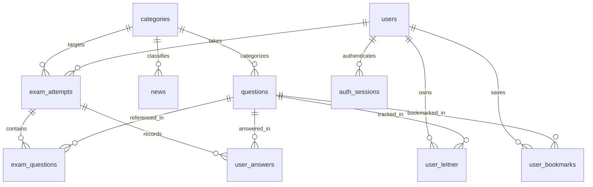

# 🗄️ مستندات پایگاه داده و دیاگرام داده‌ها (Database Schema)

پایگاه داده پلتفرم **تست ۹۸** بر مبنای موتور قدرتمند، سبک و بدون نیاز به سرور مجزای **SQLite** همراه با فعال‌سازی حالت **WAL (Write-Ahead Logging)** و ارتباطات ناهمگام با کتابخانه `aiosqlite` پیاده‌سازی شده است.

---

## ۱. تنظیمات عملکردی و همزمانی (Concurrency & PRAGMA)

در فایل `app/database.py`، هنگام باز شدن هر کانکشن پراگماهای زیر به صورت پیش‌فرض فعال می‌شوند:

```sql
PRAGMA journal_mode = WAL;          -- امکان خواندن و نوشتن همزمان با سرعت بالا
PRAGMA synchronous = NORMAL;        -- تعادل عالی بین سرعت دیسک و امنیت داده‌ها
PRAGMA busy_timeout = 10000;        -- تاخیر ۱۰ ثانیه‌ای برای جلوگیری از خطای Database Locked
PRAGMA foreign_keys = ON;           -- فعال‌سازی یکپارچگی کلیدهای خارجی و Cascade
PRAGMA cache_size = -64000;         -- تخصیص حدود ۶۴ مگابایت کش رم برای کوئری‌ها
PRAGMA temp_store = MEMORY;         -- انجام عملیات مرتب‌سازی و جداول موقت درون RAM
```

---

## ۲. دیاگرام ارتباطی جداول (Entity-Relationship Diagram)



---

## ۳. شرح تفصیلی جداول دوازده‌گانه

### ۱. جدول دسته‌بندی‌ها (`categories`)
سرفصل‌های رسمی دروس آزمون استخدامی و دسته‌های خبری:
* `code` (TEXT PRIMARY KEY): شناسه یکتای دسته (مثال: `icdl`, `laws`, `maaref`, `computer`, `employment`, `economy`)
* `name_fa` (TEXT NOT NULL): نام رسمی فارسی درس
* `description` (TEXT): شرح و منابع رسمی سنجش
* `icon` (TEXT): نام آیکون گرافیکی
* `color` (TEXT): تم رنگی در رابط کاربری
* `is_exam` (INTEGER DEFAULT 1): آیا در لیست آزمون‌ساز قرار گیرد؟
* `is_news` (INTEGER DEFAULT 0): آیا دسته خبری است؟

---

### ۲. جدول بانک سوالات (`questions`)
تست‌های چهارگزینه‌ای پالایش‌شده ادوار گذشته:
* `id` (INTEGER PRIMARY KEY AUTOINCREMENT): شناسه سوال
* `category` (TEXT NOT NULL): کلید خارجی متصل به `categories.code`
* `question_text` (TEXT NOT NULL): صورت سوال استاندارد
* `options_json` (TEXT NOT NULL): آرایه JSON حاوی ۴ گزینه به همراه شماره
* `correct_index` (INTEGER): شاخص گزینه صحیح از `0` تا `3` (در صورت `NULL`، در صف بازبینی ادمین قرار می‌گیرد)
* `explanation` (TEXT): پاسخ تشریحی جامع و نکات کلیدی طراح سوال
* `source_channel` (TEXT): مبدا استخراج (فقط قابل مشاهده در پنل مدیریت ادمین)
* `source_msg_id` (INTEGER): شناسه پیام در مبدا
* `text_hash` (TEXT UNIQUE): هش SHA-256 جهت جلوگیری دقیق از ورود تست تکراری
* `difficulty_level` (TEXT DEFAULT 'medium'): سطح دشواری (`easy`, `medium`, `hard`)
* `status` (TEXT DEFAULT 'published'): وضعیت انتشار (`published`, `needs_review`, `rejected`)
* `report_count` (INTEGER DEFAULT 0): تعداد گزارش خطای ثبت‌شده توسط کاربران
* `views_count` (INTEGER DEFAULT 0): دفعات نمایش سوال در آزمون‌ها
* `correct_answers_count` (INTEGER DEFAULT 0): دفعات پاسخ درست توسط داوطلبان
* `wrong_answers_count` (INTEGER DEFAULT 0): دفعات پاسخ اشتباه
* `created_at` (TIMESTAMP DEFAULT CURRENT_TIMESTAMP): تاریخ ثبت

---

### ۳. جدول اخبار و اطلاعیه‌ها (`news`)
دفترچه‌های آزمون، آگهی‌ها و آخرین رویدادهای استخدامی:
* `id` (INTEGER PRIMARY KEY AUTOINCREMENT): شناسه خبر
* `title` (TEXT NOT NULL): تیتر بازنویسی‌شده رسمی
* `slug` (TEXT UNIQUE NOT NULL): نامک یکتا برای آدرس‌دهی سئو (URL-friendly)
* `summary` (TEXT): چکیده خبر برای متاتگ‌های گوگل
* `content` (TEXT NOT NULL): متن کامل و بخش‌بندی‌شده
* `image_path` (TEXT): آدرس تصویر شاخص
* `category` (TEXT NOT NULL): کلید خارجی متصل به `categories.code`
* `source_channel` (TEXT): کانال مبدا
* `source_msg_id` (INTEGER): شناسه پیام در مبدا
* `views_count` (INTEGER DEFAULT 0): تعداد بازدیدها
* `cta_category` (TEXT): دسته مرتبط جهت نمایش باکس دعوت به آزمون (CTA)
* `is_published` (INTEGER DEFAULT 1): وضعیت انتشار
* `created_at` (TIMESTAMP DEFAULT CURRENT_TIMESTAMP)

---

### ۴. جدول کاربران (`users`)
داوطلبان و مدیران سامانه:
* `id` (INTEGER PRIMARY KEY AUTOINCREMENT): شناسه کاربر
* `bale_chat_id` (INTEGER UNIQUE): شناسه یکتای حساب کاربری در پیام‌رسان بله
* `bale_username` (TEXT): نام کاربری در بله (مثال: `r_e1991`)
* `phone` (TEXT UNIQUE): شماره تلفن همراه تاییدشده
* `full_name` (TEXT): نام و نام خانوادگی داوطلب استخراج‌شده از بله
* `target_exam` (TEXT): آزمون هدف استخدامی (آموزش و پرورش، فراگیر و...)
* `is_vip` (INTEGER DEFAULT 0): وضعیت اشتراک ویژه
* `role` (TEXT DEFAULT 'user'): سطح دسترسی (`user` داوطلب عادی، `admin` مدیر کل)
* `created_at` (TIMESTAMP DEFAULT CURRENT_TIMESTAMP)

---

### ۵. جدول نشست‌های احراز هویت (`auth_sessions`)
مدیریت لینک‌های ورود جادویی و کدهای یک‌بار مصرف OTP بله:
* `token` (TEXT PRIMARY KEY): توکن امن تصادفی نشست مرورگر
* `guest_token` (TEXT): توکن مهمان جهت الحاق سوابق آزمون به کاربر پس از ورود
* `user_id` (INTEGER): شناسه کاربری پس از تایید هویت
* `otp_code` (TEXT): کد ۴ رقمی یک‌بار مصرف
* `status` (TEXT DEFAULT 'pending'): وضعیت (`pending`, `verified`, `expired`)
* `created_at` (TIMESTAMP DEFAULT CURRENT_TIMESTAMP)
* `expires_at` (TIMESTAMP NOT NULL): تاریخ و زمان انقضای کد (معمولاً ۱۵ دقیقه)

---

### ۶. جدول آزمون‌های برگزارشده (`exam_attempts`)
سابقه هر آزمون، درصد نهایی و تراز داوطلب:
* `id` (INTEGER PRIMARY KEY AUTOINCREMENT): شناسه آزمون
* `user_id` (INTEGER REFERENCES users(id)): داوطلب لاگین‌شده (یا `NULL` برای مهمان)
* `guest_token` (TEXT): شناسه کوکی مهمان
* `exam_type` (TEXT DEFAULT 'custom'): نوع آزمون (`custom`, `global`, `practice`)
* `category` (TEXT NOT NULL): دسته درس یا `all` برای آزمون جامع
* `total_questions` (INTEGER NOT NULL): تعداد کل سوالات
* `correct_count` (INTEGER DEFAULT 0): تعداد درست
* `wrong_count` (INTEGER DEFAULT 0): تعداد غلط
* `unanswered_count` (INTEGER DEFAULT 0): تعداد نزده
* `raw_score` (REAL DEFAULT 0.0): درصد نمره خام با اعمال نمره منفی یک‌سوم
* `t_score` (REAL): تراز استاندارد کشوری (مقیاس ۱۰۰ تا ۱۰۰۰ با میانگین ۵۰۰)
* `rank` (INTEGER): رتبه داوطلب در مقایسه با سایر شرکت‌کنندگان
* `has_negative_marking` (INTEGER DEFAULT 1): آیا نمره منفی یک‌سوم دارد؟
* `started_at` (TIMESTAMP DEFAULT CURRENT_TIMESTAMP): زمان شروع
* `expires_at` (TIMESTAMP NOT NULL): پایان مهلت زمان آزمون
* `is_finished` (INTEGER DEFAULT 0): وضعیت اتمام آزمون
* `finished_at` (TIMESTAMP): زمان پایان واقعی

---

### ۷. جدول اسنپ‌شات سوالات آزمون (`exam_questions`)
* `id` (INTEGER PRIMARY KEY AUTOINCREMENT)
* `attempt_id` (INTEGER REFERENCES exam_attempts(id) ON DELETE CASCADE)
* `question_id` (INTEGER REFERENCES questions(id))
* `question_order` (INTEGER NOT NULL): ترتیب نمایش سوال برای داوطلب

---

### ۸. جدول پاسخ‌های ریز داوطلب (`user_answers`)
* `id` (INTEGER PRIMARY KEY AUTOINCREMENT)
* `attempt_id` (INTEGER REFERENCES exam_attempts(id) ON DELETE CASCADE)
* `user_id` (INTEGER REFERENCES users(id))
* `guest_token` (TEXT)
* `question_id` (INTEGER REFERENCES questions(id))
* `selected_option` (INTEGER): گزینه انتخابی (0 تا 3 یا NULL برای نزده)
* `is_correct` (INTEGER): ۱ برای درست، ۰ برای غلط، NULL برای نزده
* `answered_at` (TIMESTAMP DEFAULT CURRENT_TIMESTAMP)

---

### ۹. جدول جعبه لایتنر هوشمند (`user_leitner`)
سامانه مرور زمان‌بندی‌شده سوالات نادرست داوطلب:
* `id` (INTEGER PRIMARY KEY AUTOINCREMENT)
* `user_id` (INTEGER REFERENCES users(id) ON DELETE CASCADE)
* `question_id` (INTEGER REFERENCES questions(id) ON DELETE CASCADE)
* `box_level` (INTEGER DEFAULT 1): شماره خانه از ۱ تا ۵
* `consecutive_correct` (INTEGER DEFAULT 0): تعداد پاسخ صحیح متوالی
* `next_review_at` (TIMESTAMP DEFAULT CURRENT_TIMESTAMP): موعد مرور بعدی
* `last_reviewed_at` (TIMESTAMP DEFAULT CURRENT_TIMESTAMP)
* *محدودیت:* `UNIQUE(user_id, question_id)`

---

### ۱۰. جدول سوالات نشان‌شده (`user_bookmarks`)
* `id` (INTEGER PRIMARY KEY AUTOINCREMENT)
* `user_id` (INTEGER REFERENCES users(id) ON DELETE CASCADE)
* `question_id` (INTEGER REFERENCES questions(id) ON DELETE CASCADE)
* `created_at` (TIMESTAMP DEFAULT CURRENT_TIMESTAMP)
* *محدودیت:* `UNIQUE(user_id, question_id)`

---

### ۱۱. جدول پارامترهای آماری تراز (`exam_statistics`)
* `id` (INTEGER PRIMARY KEY AUTOINCREMENT)
* `exam_identifier` (TEXT UNIQUE NOT NULL): شناسه گروه آزمون (مثال: `global_all`)
* `total_participants` (INTEGER DEFAULT 0): تعداد داوطلبان شرکت‌کرده
* `mean_score` (REAL DEFAULT 0.0): میانگین جامعه آماری ($\mu$)
* `std_dev` (REAL DEFAULT 0.0): انحراف معیار جامعه آماری ($\sigma$)
* `calculated_at` (TIMESTAMP DEFAULT CURRENT_TIMESTAMP)

---

### ۱۲. جدول وضعیت کانال‌ها (`crawler_channels`)
* `id` (INTEGER PRIMARY KEY AUTOINCREMENT)
* `channel_username` (TEXT UNIQUE NOT NULL): آیدی کانال تلگرامی
* `content_type` (TEXT NOT NULL): نوع محتوا (`question`, `news`, `mixed`)
* `category_code` (TEXT NOT NULL): کد ماژول مقصد
* `last_crawled_at` (TIMESTAMP): آخرین زمان سرکشی نوبتی
* `oldest_msg_id` (INTEGER): قدیمی‌ترین شناسه برای پیمایش به عقب آرشیو
* `total_extracted` (INTEGER DEFAULT 0): کل رکوردهای استخراج‌شده
* `is_active` (INTEGER DEFAULT 1): وضعیت فعالیت کانال
